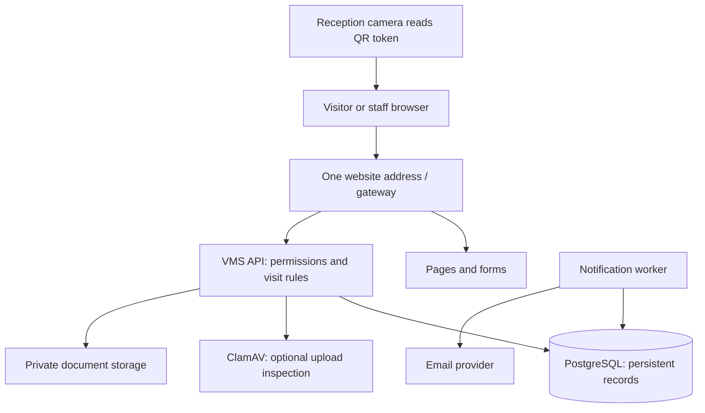

# VMS setup guide: local testing, then deployment

> Historical setup record for the earlier backend. For the current SIHP-aligned backend, follow [backend setup](../backend/README.md) and [local development](../backend/docs/LOCAL-DEVELOPMENT.md). The current implementation provides public catalogs and health checks; identity, bookings and SMTP are pending. Commands, ports and backend file links below describe the earlier implementation and must not be used to configure the current backend.

Initial inventory checked on 10 November 2026, WITA. The user-approved local Docker upgrade completed on 11 November: nine migrations, reviewed API/worker and real site at `http://127.0.0.1:3010`. This guide separates your manual account/device steps from application configuration. Email integration and public registration remain disabled; the user confirmed receipt from the separate one-off SMTP test.

## What is already set up

| Item | Observed state | Next step |
| --- | --- | --- |
| Docker | Client and engine 29.4.2 respond | Keep Docker Desktop running for local testing |
| VMS PostgreSQL | Same PostgreSQL 18.6 container/volume, healthy at `127.0.0.1:55432` | Preserve protected backups and review later upgrades |
| VMS API | Reviewed release healthy at `http://127.0.0.1:8081` | Use through the real site's `/v1` gateway |
| Notification worker | Reviewed release running; integration disabled and queue empty | Configure SMTP privately, then accept a controlled booking notification |
| Applied migrations | 001–009; all checksums verified and original six timestamps preserved | No further migration is needed for this setup step |
| Staff accounts | Employee count zero at cutover completion | Run the masked administrator bootstrap command below |
| Visit catalogs and privacy | Zero officials, zero rooms and zero published notices in the selected database | Supply and load reviewed catalog data and approved notice text |
| Email | User confirmed receipt from the separate local SMTP check; staff integration was last observed disabled/unconfigured | Save the account in the real integration after the reviewed backend rollout, then verify a booking notification |
| Private Docker settings | `.env.docker.local` exists | Preserve it; initialization is unnecessary on this PC |
| Frontend | Real site running at `http://127.0.0.1:3010/admin/`; real session request verified, zero preview requests | Create the administrator and sign in |
| QR | Generation and validation exist in source | Test an actual reception device against the real backend |
| Recovery | Four rehearsals passed; fresh protected pre-cutover backup and settings copy verified | Retain recovery material and plan recurring backups before deployment |

Other database services exist on this PC. This guide's local target is **VMS PostgreSQL on port 55432**. Do not use port 5432 interchangeably.

The earlier `btree_gist` owner mismatch was subsequently corrected on the isolated copy by the rehearsal workflow. The refreshed baseline evidence records a passed result. Separate saved results also record a passed isolated upgrade and application smoke; these results do not authorize or establish a live upgrade, physical camera scanning or SMTP delivery.

## How the parts fit together



Docker runs the database, API and worker in separate containers. A container is a running service; an image is its packaged program; a volume holds persistent data. The current Compose file does not include the frontend, website gateway or ClamAV.

The API makes decisions and checks permissions. PostgreSQL remembers them. The worker reads queued notifications from PostgreSQL and sends them through SMTP. This project does not require Redis or a separate message-queue service for its current notification design.

## The ordered checklist

| Order | Item | Your manual part | Configuration/application part | Completion evidence |
| --- | --- | --- | --- | --- |
| 1 | Docker and database | Keep Docker Desktop available; identify the intended database | Check versions, recovery and migration compatibility | Healthy services plus a successful isolated restore and upgrade rehearsal |
| 2 | Real frontend connection | Use the agreed browser address | Route `/v1` correctly and select real data | Staff sign-in reaches the selected database |
| 3 | Administrator and staff | Enter initial credentials privately; decide role assignments | Bootstrap and configure roles | Sign-in, forced password change and permission checks work |
| 4 | Visit catalogs and policy | Supply approved officials, positions, rooms, assignments and notice text | Load reviewed records and publish the approved notice | Correct catalogs and notice version are returned |
| 5 | SMTP | Obtain account/relay access and a permitted sender | Allowlist host; save integration; run worker | A synthetic notification is received and queue state is checked |
| 6 | QR reception | Choose device/browser; allow camera access | Verify backend and browser behavior | Valid, replaced, cancelled, repeated and expired credentials behave correctly |
| 7 | Optional documents | Decide whether uploads are needed and who may access/retain them | Add private storage, scanner and configuration | Upload/download, denied access and scanner-outage checks pass |
| 8 | Recovery | Choose backup destination, operators and recovery objectives | Schedule backups and restore checks | Isolated restore works with database, files and key |
| 9 | Deployment | Obtain server, domain/DNS access and email approval | Production gateway, HTTPS, services and monitoring | Real-device and restart/recovery checks pass at the final address |
| 10 | Launch | Approve collection and operating ownership | Enable registration in the deployment configuration | Complete visitor-to-reception flow passes |

## 1. Docker and PostgreSQL

**How they work.** PostgreSQL stores visits, staff, permissions, QR validation records, audit events and email jobs. Database passwords let services connect to PostgreSQL; they are separate from the staff email/password used on the website. The migration account changes tables and grants; the application account runs normal requests with fewer privileges.

**On this PC:** installation and initial database provisioning are already done. Docker Desktop can be opened from the Start menu. Its WSL 2 engine and Linux containers are the project's local route; see [Docker's WSL 2 instructions](https://docs.docker.com/desktop/features/wsl/).

For a safe status check in PowerShell:

```powershell
Set-Location D:\oikn\VMS\backend
docker version
.\scripts\Run-Docker.ps1 -Command status
Invoke-RestMethod http://127.0.0.1:8081/health/ready
```

Expected: database and API healthy, worker running, migration service exited with code 0, and readiness reports ready. These checks describe the running version.

**Upgrade checkpoint:** the approved 007–009 update is complete. Use status/readiness for this setup step. `Run-Docker.ps1 -Command up` builds current source and can replace services/apply later migrations, so treat future source upgrades as deliberate release operations.

Inside Docker, the API connects to `db:5432`; from Windows, database tools use `127.0.0.1:55432`. `127.0.0.1` inside an API container refers to that API container, not the database container.

For a genuinely new installation, the existing `Initialize-Docker.ps1` generates private settings, database credentials and a 32-byte application key. Do not regenerate them over an existing database. Editing initialization passwords does not rotate passwords stored in an existing PostgreSQL volume.

A database management app such as pgAdmin is optional. If used, connect to the chosen database and use credentials privately; no database GUI is needed to run VMS.

## 2. Connect the frontend to the actual backend

**How it works.** The browser should use one address. Its pages send requests to `/v1` at that same address, and a gateway forwards those requests to the API. This keeps browser sessions and request-origin checks consistent.

The normal development workflow has two limitations for real setup:

1. Select actual backend requests. `packages/data/src/config.ts` currently enables demo data whenever the frontend is a development build on localhost/loopback. There is no existing documented environment switch that turns this off.
2. Route API requests to Docker's port 8081. Both current Vite proxies target the native API port 8080.

A local launcher is now provided in [REAL-BACKEND-LOCAL.md](frontend/REAL-BACKEND-LOCAL.md). It serves the production builds (which select actual API requests) and forwards `/v1` to an explicitly selected loopback API. This avoids changing the normal demo workflow or introducing another data-mode flag. It does not start or upgrade a backend, create an administrator or activate email. Request/response transport and route/security boundaries passed a focused local test with a disposable synthetic HTTP upstream; this is not a fresh real-login or SMTP acceptance result.

The real local site now runs on port 3010 with API target 8081. To restart it, use `npm.cmd run serve:backend -- --api http://127.0.0.1:8081 --port 3010` from `frontendx`, with Docker Desktop and the upgraded backend running. Setting `VITE_API_BASE_PATH=/v1` alone does not solve demo selection or the upstream port.

Use `http://127.0.0.1:3010`, including its `/admin/` route for staff. `VMS_ORIGIN` now matches that exact address. Scheme, hostname and port must match, with no path. `localhost` and `127.0.0.1` are different origins.

## 3. Create the administrator and staff accounts

**Your part:** choose the administrator name/email and create a private initial password in your password manager. Enter it in the local prompt; do not send it in chat.

**The compatible database/application upgrade is complete.** Run this command privately to create the first administrator:

```powershell
Set-Location D:\oikn\VMS\backend
.\scripts\Run-Docker.ps1 -Command bootstrap
```

It prompts for name, email and a masked initial password. It works only while the employee directory is empty. First sign-in requires a password change. The initial password must meet the configured policy; the current default minimum is 12 characters.

Then create the required staff and assign their actual roles, including a Receptionist for arrival/departure operations. Test each role. PostgreSQL role names and generated database passwords are not website sign-in credentials.

## 4. Provide the real visit catalog and privacy notice

**Your part:** supply reviewed officials, their positions, rooms, staff assignments, and approved Indonesian/English privacy text. Decide the organization contact and retention rules. For local workflow tests use synthetic identities and a clearly labelled test notice.

**My part:** prepare the matching catalog records and notice publication for the selected schema. There is no general catalog-management screen/API in the current backend, so these records need a controlled setup step; a blank list is not fixed by SMTP or Docker.

Keep genuine public registration disabled until the approved notice and collection decision are in place. The current Compose file explicitly sets registration to false; adding a true value only to the private settings file will not override that literal value. Enabling it later needs a reviewed deployment configuration change.

## 5. Set up SMTP email

**How it works.** A visit event records an email job in PostgreSQL. The worker sends it through your provider, using encrypted transport and the configured sender. Saving an integration does not prove delivery; the worker must be running and a message must actually reach the test inbox.

**Selected temporary route:** the user supplied `smtp.gmail.com` and confirmed access to Google App Passwords. Use port **465** with implicit TLS; the supplied `456` is not Google's documented SSL SMTP port. Use the supplied account as both username and sender in the private integration form. Recipient selection already uses the visitor email stored in each ordinary booking; there is no fixed recipient setting to enter. Keep the account details and generated app password in the private setup workflow rather than this general guide.

Obtain these from your email administrator or provider:

| Value | What to obtain | Where it belongs |
| --- | --- | --- |
| SMTP host | Provider's exact outgoing-mail hostname | Deployment allowlist and VMS Email SMTP form |
| Port | 587 with STARTTLS or 465 with implicit TLS | Email SMTP form |
| Sender email | Address the provider permits VMS to send as | Email SMTP form |
| SMTP username | Provider's required login, if applicable | Email SMTP form |
| SMTP password | Dedicated SMTP credential or permitted app password | Secret field in Email SMTP form; never chat or frontend variables |

The current adapter supports username/password authentication over verified TLS, or a compatible relay without username authentication. OAuth-only access needs adapter work. Plaintext SMTP on a typical local port such as 1025 is not directly compatible with the current integration validation.

Setup sequence:

1. Choose a provider/account permitted for the intended use. A separate test account can serve local tests; deployment should use an organization-approved sender.
2. Obtain the five values above. If using a custom sender domain, have its administrator apply the provider's exact domain verification, SPF, DKIM and DMARC instructions. Avoid pasting a generic DNS record over existing mail configuration. See the primary explanations for [SPF](https://knowledge.workspace.google.com/admin/security/set-up-spf), [DKIM](https://knowledge.workspace.google.com/admin/security/set-up-dkim) and [DMARC](https://knowledge.workspace.google.com/admin/security/set-up-dmarc).
3. Compose now reads `VMS_SMTP_ALLOWED_HOSTS` from its explicit private environment file for both API and worker; it defaults to an empty allowlist. Set `VMS_SMTP_ALLOWED_HOSTS=smtp.gmail.com` in `.env.docker.local` for this selected route. The setting only reaches running services during a later reviewed configuration rollout; editing the file does not activate SMTP.
4. Keep the existing `VMS_SECRET_KEY` consistent between API and worker. It encrypts saved SMTP passwords and protects upload tokens. Preserve it with protected recovery settings.
5. In the real staff application, sign in as Super Admin, open **Integrasi**, configure **Email SMTP**, enter the values and enable it. The form intentionally does not display saved passwords.
6. Trigger one reviewed synthetic notification to an inbox you control. Confirm receipt, sender, content and delivery status. Also verify retry behavior. There is no assumed “Send test email” button in these instructions.

**If Gmail is selected:** enable 2-Step Verification on the test account, then use Google's [app-password instructions](https://support.google.com/accounts/answer/185833?hl=en). Where the account permits it, generate an app password for VMS; use `smtp.gmail.com`, port 587 or 465, the full email address as username, and that app password. Organization policies or Advanced Protection may make app passwords unavailable. Google's [SMTP setup instructions](https://knowledge.workspace.google.com/admin/gmail/send-email-from-a-printer-scanner-or-app) also distinguish Gmail SMTP from administrator-managed relay. Do not assume an ordinary Google account password or an OAuth-only account will work here.

**Current manual step completed:** the user created/saved an app password and reported receiving the controlled one-off test message. Keep that password private. When the real integration form is ready, enter it locally as the SMTP password. The app's port value selects implicit TLS automatically for 465. Persistent integration settings, worker delivery and booking-event acceptance remain pending.

The completed [local SMTP check](../backend/docs/SMTP-LOCAL-CHECK.md) takes the app password in a masked local prompt and sends exactly one test message to the selected account by default. It uses the application's existing SMTP adapter, accesses no database, consumes no visitor queue and does not save the password. Do not repeat the successful send merely for another status check.

## 6. Set up and test QR reception

**How it works.** The backend issues a random token for an approved visit and stores its hash with expiry/revocation state. The frontend renders the token as a QR image. Reception reads it and asks the backend to resolve and validate the visit before attendance is recorded. A replacement QR revokes the previous one.

There is no external QR subscription, QR API key or separate QR server to set up. This admission flow uses database-backed random tokens; `VMS_SECRET_KEY` is not a separate QR signing key. Validation needs the backend online.

Your device steps, after real frontend integration:

1. Choose the actual reception computer/phone and camera.
2. Open the real staff site, sign in with Receptionist permissions, open reception and choose **Scan QR**.
3. Select **Aktifkan kamera** and allow camera access in the browser. Check Windows camera privacy settings if access is blocked.
4. Show a valid synthetic visit's QR on another screen and verify the visit details before confirming attendance.
5. Verify replacement and cancellation reject the old QR, repeated check-in is rejected, expiry prevents a new arrival, and checkout works for an already checked-in visit. A checked-in credential may remain usable for checkout after arrival expiry; test that separately.
6. Test **kode kunjungan** as the alternative when camera scanning is unavailable.

The current scanner depends on browser `BarcodeDetector` support, which varies by browser and platform; verify the specific device instead of assuming a browser name guarantees support. See [browser support](https://developer.mozilla.org/en-US/docs/Web/API/BarcodeDetector).

Camera access needs a secure context, normally HTTPS, with a localhost development exception. Opening a plain HTTP LAN address on a phone is not equivalent to localhost on that phone. Use trusted HTTPS for network/device testing and deployment. See [camera requirements](https://developer.mozilla.org/en-US/docs/Web/API/MediaDevices/getUserMedia). A USB scanner is not required, and its keyboard-output behavior has not been established for this UI.

## 7. Optional private documents and ClamAV

Set this up only if the visit workflow needs supporting files.

**How it works.** The API inspects supported uploads through ClamAV and stores accepted bytes in private storage. Downloads require current authorization; the private folder must not be served as ordinary website files.

Setup requires all of these together:

| Setting | Example / meaning |
| --- | --- |
| `VMS_FILES_ROOT` | Absolute path inside the API environment, such as `/var/lib/vms/files`, backed by a private persistent volume |
| `VMS_CLAMAV_ADDRESS` | Private scanner service address, for example `clamav:3310` after adding a service with that name |
| `VMS_UPLOAD_TOKEN_TTL` | Explicit operational choice such as `15m`; this is not a file-retention period |
| `VMS_SECRET_KEY` | Existing protected application key |

The current Compose file has no scanner, files volume or document settings. These examples describe a configuration to prepare, not services already present.

I can add a private scanner service and storage mount. You decide storage access, retention, backup ownership and whether documents are needed. ClamAV needs current signatures and sufficient resources; follow its [official Docker setup](https://docs.clamav.net/manual/Installing/Docker.html). Its TCP daemon does not authenticate callers and must remain private; see [ClamAV networking](https://docs.clamav.net/manual/Usage/Scanning.html).

Verify a clean supported file, denied download, rejected unsafe/malformed file, scanner outage and restart persistence. The backend limit is 5 MiB for PDF/JPEG/PNG. The current application has no automatic retention/deletion job; token expiry does not delete files.

## 8. Backups and recovery

**Your part:** choose who can restore, a protected destination separate from the active data, how much recent work may be lost, how quickly service must return, and retention periods.

**Configuration part:** back up PostgreSQL plus private documents and access to the matching encryption key/settings. A Docker volume makes data survive container replacement; it is not a backup. A database dump alone is incomplete when private files or encrypted SMTP settings are needed.

Rehearse restore into a separate target, verify data/schema/permissions/extensions, check file links and notification state, and keep restored services disconnected from live email until reviewed. The latest saved baseline comparison passed; the remaining independent recovery/cutover review is separate. The retained application-smoke copy includes synthetic notification jobs, so do not casually enable a real SMTP worker against it.

## 9. Deploy after local acceptance

Provider-specific commands depend on the actual server, operating system and DNS owner. First collect these non-secret details:

- Server location, operating system, resource allocation and administrator access route.
- Intended public or intranet-only access and network/DNS ownership.
- Final hostname and certificate owner.
- Organization-approved SMTP route and sender.
- Backup destination and responsible operator.

Then use this deployment sequence:

1. Provision a separate production database, credentials, persistent storage and application key. Keep local test configuration separate.
2. Deploy the tested API/worker version and matching migrations; use the migration account only for release operations and the runtime account for services.
3. Build both frontend applications. Serve visitor files at `/` and staff files at `/admin/`, with their appropriate page fallbacks. Forward `/v1/*` to the API before page fallback rules.
4. Point the chosen hostname to the gateway and configure trusted HTTPS with certificate renewal. The certificate provider or organization's PKI determines validation; [Let's Encrypt's setup overview](https://letsencrypt.org/getting-started/) explains its ACME route.
5. Set `VMS_ENV=production`, `VMS_ORIGIN=https://the-approved-hostname` and actual trusted proxy addresses. Apply these through a production configuration; the existing development Compose file contains literal development/disabled settings and is not a production deployment recipe.
6. Keep database and scanner access private. If PostgreSQL is accessed across a separate host/network, use verified database TLS. Publish the website gateway; provide administration through the organization's chosen restricted route.
7. Configure SMTP, staff, catalogs, notice, optional documents, scheduled backups and monitoring. Monitor API readiness/errors, worker backlog/failed deliveries, storage and database capacity, scanner signature health and certificate renewal.
8. Run the real visit workflow on the actual reception device, test permissions and restart/recovery, then review enabling genuine public registration.

A domain and HTTPS certificate do not replace application configuration or email-domain authentication. SMTP DNS records and the website's DNS address serve different purposes.

## Keep three kinds of credentials separate

| Credential | Purpose | Who/what uses it |
| --- | --- | --- |
| PostgreSQL owner/runtime passwords | Connect to and administer the database | Migration process, API and worker |
| Staff account password | Sign in to VMS | Administrator, staff and reception |
| SMTP credential | Send notification emails | Notification worker |

`VMS_SECRET_KEY` protects stored SMTP secrets and upload tokens. Back it up securely and do not replace it casually. Keep all secrets out of chat, Git, screenshots and `VITE_*` values, which are included in browser code.

## Next guided step

The approved local upgrade and real sign-in page checks are complete, and the user confirmed receipt from the standalone SMTP test. Create the administrator with the masked bootstrap command, sign in at `http://127.0.0.1:3010/admin/`, complete the required password change, and enter the app password in Email SMTP. Persistent SMTP settings and booking-event delivery remain pending until those manual steps and their acceptance are completed. Choose the reception device and identify the eventual server/DNS owner in parallel.

## Project evidence

- [Compose configuration](../backend/compose.yaml), [Docker helper](../backend/scripts/Run-Docker.ps1) and [Docker setup](../backend/docs/DOCKER.md).
- [Configuration loader](../backend/config/config.go), [operations runbook](../backend/docs/OPERATIONS.md) and [migration files](../backend/migration/files).
- [Frontend preview selection](../frontendx/packages/data/src/config.ts), [visitor proxy](../frontendx/apps/visitor/vite.config.ts) and [staff proxy](../frontendx/apps/admin/vite.config.ts).
- [SMTP settings and validation](../backend/internal/usecase/integrations/settings.go), [SMTP adapter](../backend/internal/platform/mail/smtp.go) and [worker](../backend/cmd/worker/main.go).
- [QR admission behavior](../backend/internal/usecase/visits/admission.go) and [camera scanner](../frontendx/apps/admin/src/features/Scanner.tsx).
- [Latest saved restore result](../backend/docs/evidence/2026-11-10/gap-3-baseline-restore.json), [isolated upgrade](../backend/docs/evidence/2026-11-10/gap-3-isolated-upgrade.json) and [application smoke](../backend/docs/evidence/2026-11-10/gap-3-application-smoke.json). Container state and migration/account/email counts were checked read-only during the initial inventory. Older overview documents contain historical statements; use source and current checks for setup decisions.
